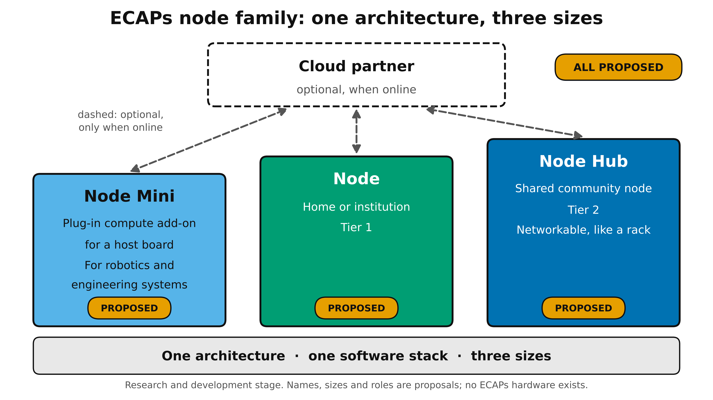
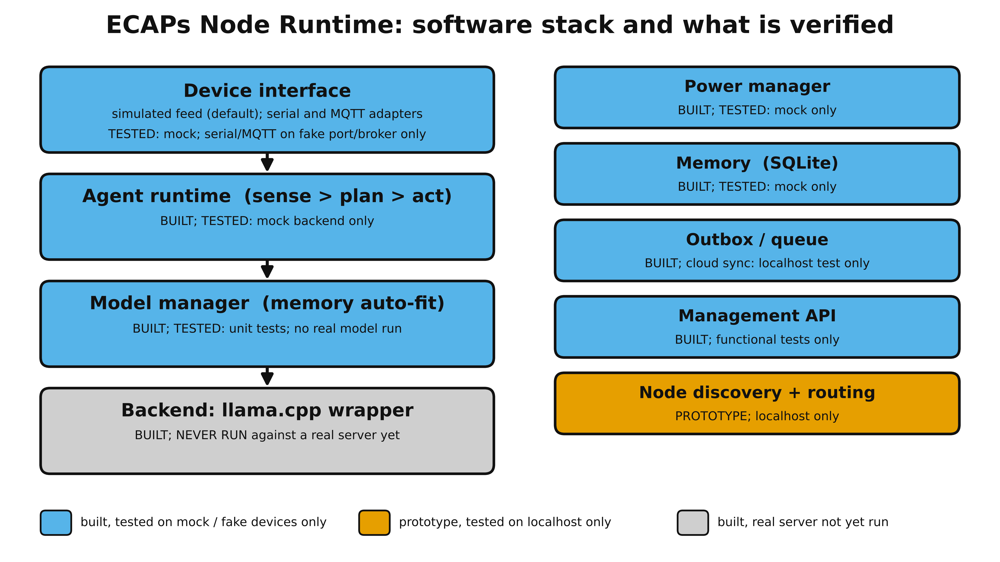
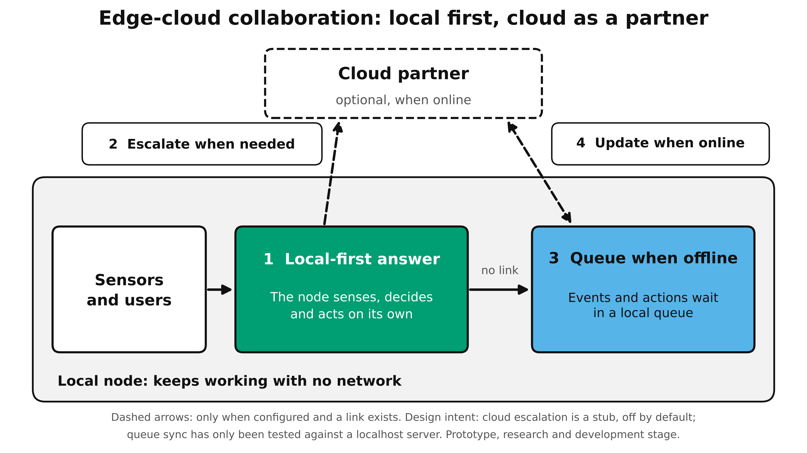

# ECAPs Node Runtime

> **Research and development stage. This is a prototype.**
> ECAPs (Edge Computing Agentic Processors) hardware does not exist yet; there is no ECAPs silicon.
> This repo is the *software runtime* that would run on such a node. Any benchmark here is meant to be measured on a
> **stand-in reference machine** (an ordinary CPU-only PC), **not ECAPs silicon**.
>
> **No real benchmark results have been produced yet.** The code was developed and tested on a labelled mock backend.
> The real run happens on the owner's PC with `python -m bench.run_all`.

## What this is
ECAPs is a proposed family of edge-AI nodes: **Node Mini** (a plug-in compute add-on for a host board, for robotics and engineering systems),
**Node** (home or institution, Tier 1) and **Node Hub** (a shared community node, Tier 2, networkable like a rack): one architecture, one software
stack, three sizes. All of that is **proposed**. This repository is the software layer of that idea: a small Python runtime that runs local AI agents
(sense, plan, act) on a CPU-only machine by wrapping [llama.cpp](https://github.com/ggml-org/llama.cpp), keeps working with no network, and treats the
cloud as an optional partner. It makes no speed claim against llama.cpp. Energy is **not measured** (CPU-seconds per task is only a proxy), and the memory
budget is a **software setting**, not a change to physical RAM.

| Node family (proposed) | Software stack (what is verified) | Edge-cloud collaboration |
|---|---|---|
|  |  |  |

The diagrams contain no results and no specifications (`python -m assets.make_diagrams` regenerates them). The size/power/bandwidth table in
[`docs/NODE_SPEC_PROPOSED.md`](docs/NODE_SPEC_PROPOSED.md) is proposed arithmetic, not measurement.

## What is verified / not verified (today)

| Area | What was done | What was **not** done |
|---|---|---|
| Whole test suite (`pytest`) | passes on the mock backend, fake serial port, fake MQTT broker and localhost processes | never run against a real model |
| llama.cpp backend, model manager, agent loop | unit and mock-backend tests; auto-fit formula from the project brief | no real `llama-server` run; no real model output seen |
| Benchmarks B1-B4, figures F1-F4, `summary.md` | pipeline runs end to end on **mock data** (output watermarked DUMMY, git-ignored) | **no real numbers exist**; nothing here is a measurement |
| Power modes | logic unit-tested with a **simulated** battery/solar level; eco's 64-token cap is a placeholder to re-check | no effect of a mode has been measured; no power or energy measured |
| Serial / ESP32 adapter | tested against a fake port | the example sketch (`docs/ESP32.md`) was **never compiled or run**; no real ESP32 |
| MQTT adapter | tested against an in-memory fake broker | never run against a real broker or device |
| Offline outbox | local loop proven to work with the network blocked; nothing goes out unless a cloud URL is configured; sync tested against a localhost server | no real cloud service; cloud escalation is a stub, off |
| Discovery and routing | three processes on localhost: discovery, hand-off, a peer dying | no real LAN, no firewalls, no throughput measurement |
| Management API | functional tests | not benchmarked; no authentication |
| Licences | base models and llama.cpp recorded in [`docs/MODELS.md`](docs/MODELS.md) with sources and the check date (17 Oct 2026, relayed, not re-checked in the build sandbox) | GGUF conversion repos and Python libraries not recorded |
| Proposed node spec and solar example | arithmetic is tested and reproducible | inputs are proposals and assumptions; sun-hours data is old and not for the deployment site |

## Security status
**This is an unhardened research prototype. No authentication or TLS has been added, on purpose, for now.** Do not expose any of its ports to the internet,
and do not run it on an untrusted network.

| Component | Exposure | Status |
|---|---|---|
| Management API (`ecaps.api`) | read-only GET (`/status`, `/models`, `/metrics`) | binds to 127.0.0.1 by default; **no authentication, no TLS** |
| Cluster prototype (`ecaps.cluster`) | `POST /generate` and UDP announcements | binds to 127.0.0.1 unless `--host` is changed; announcements are **unauthenticated and can be spoofed** on a LAN; the optional shared token is sent **in clear text** over HTTP; no TLS |
| Cloud sync | outbound only, **off** unless `cloud.enabled` and a URL are set | bearer token (env var) is only protected if the URL is `https://`; `http://` is accepted (used for localhost tests) |
| MQTT adapter | outbound to a broker you choose | no TLS; credentials travel in clear over plain MQTT; broker access control is not managed here |
| Serial / ESP32 | a physical cable | no authentication |
| Local data | SQLite memory and outbox files | **not encrypted**; they hold sensor values and the actions taken |
| Agent actions | model output is untrusted | only the registered tools can run (`set_pump`, `log_alert`, `read_sensor`, `noop`), with validated arguments and length limits; no shell or file access |
| Models and binaries | downloaded by you | this repo does not check checksums or signatures; use the official sources in `docs/MODELS.md` and `docs/RUN_ON_PC.md` |

No security review or penetration test has been done. Adding authentication and TLS is future work.

## Quick start (no model needed)
    pip install -r requirements.txt
    pytest
    python -m bench.run_all --mock     # plumbing check; DUMMY output goes to results_dummy/ (git-ignored)
    python -m ecaps.model_manager --budget-gb 4
    python -m ecaps.api --mock         # management API on http://127.0.0.1:8700 (DUMMY backend)

## How to run the real benchmarks on your PC
The full Windows guide is [`docs/RUN_ON_PC.md`](docs/RUN_ON_PC.md). In short:
1. `pip install -r requirements.txt` (Python 3.11+).
2. Put a CPU `llama-server` binary in `bin/` (or pass `--llama-server`) and the GGUF files named in [`docs/MODELS.md`](docs/MODELS.md) in `models/`.
   Download the **smallest model first**; nothing is downloaded for you.
3. `python -m bench.preflight --only b1,b3` (checks only), then `python -m bench.run_all --only b1,b3`.
4. After downloading the other models: `python -m bench.run_all --only b2`, then `--only b4` (or one plain `python -m bench.run_all` for everything).
   Real mode needs at least 5 repeats.
5. Outputs: `results/environment.json`, raw `results/*.json`, `results/figures/` (PNG 300 dpi + SVG with hardware, date, model and commit footers) and
   `results/summary.md` (every number, captions, and an "Unverified or not measured" list). Nothing is typed by hand.
6. Before printing anything: `python -m bench.check_results`, and follow [`docs/POSTER_FIGURE_SLOTS.md`](docs/POSTER_FIGURE_SLOTS.md).

`results_dummy/` holds mock output only. It is watermarked DUMMY and must never be used on a poster.

## Optional pieces
- Serial/ESP32: [`docs/ESP32.md`](docs/ESP32.md). MQTT: topic scheme in `ecaps/mqtt_device.py`. Select a device in `ecaps.config.json` (`"device"`).
- Cloud sync is **off**; it runs only if `ecaps.config.json` sets `"cloud": {"enabled": true, "url": "..."}`.
- Cluster prototype (localhost-tested only): `python -m ecaps.cluster --id A --port 8801 --discovery-port 47801 --mock`.
  More nodes serve more users; one model is **not** split across nodes.

## Docs
[`docs/DESIGN.md`](docs/DESIGN.md) (design decisions and limits) ·
[`docs/MODELS.md`](docs/MODELS.md) (models, sizes, licences) ·
[`docs/RUN_ON_PC.md`](docs/RUN_ON_PC.md) (run the real benchmarks) ·
[`docs/POSTER_FIGURE_SLOTS.md`](docs/POSTER_FIGURE_SLOTS.md) (poster slots, footers, DUMMY rule) ·
[`docs/NODE_SPEC_PROPOSED.md`](docs/NODE_SPEC_PROPOSED.md) (proposed, not measured) ·
[`docs/ESP32.md`](docs/ESP32.md) (device protocol, untested sketch)

## Layout
    ecaps/    backend, model_manager, agent, tools, memory, power, node, devices, mqtt_device, outbox, cluster, api, spec_calc
    bench/    run_all, preflight, check_results, b1..b4, figures, summary
    assets/   make_diagrams.py and the poster concept diagrams (no results)
    docs/     design, models/licences, run guide, poster slots, proposed spec, ESP32 protocol
    tests/    pytest suite (mock backend, fake serial port, fake MQTT broker, localhost cluster)

License: MIT (see `LICENSE`).
